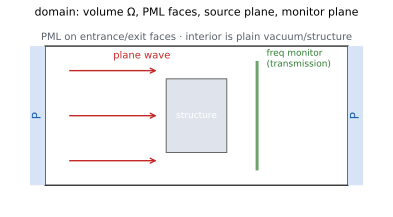

# 01 · f.domain — physical domain & boundaries

> Domain size (per-axis ranges), total time, CFL, and boundary conditions on
> the six faces. All SI. Property assignments write straight to the config.



## `f.domain` properties

| Property | Type / unit | Description |
|---|---|---|
| `x_range` / `y_range` / `z_range` | (lo, hi) 2-tuple, m | Physical domain extent per axis, `lo < hi` (guarded server-side by `_check_range`) |
| `total_time` | s, > 0 | Total simulated time — the **single** definition of simulation length; at build the server derives the step count from it via dt (a read-only value reported in `summary`/`results`; there is no `run.n_steps`) |
| `cfl` | float, default 0.9, `0 < cfl ≤ 1` | Fraction of the stability limit dt uses; leave alone, lowering buys stability margin at the cost of more steps |

```python
f.domain.x_range = (-1e-6, 1e-6)
f.domain.y_range = (-1e-6, 1e-6)
f.domain.z_range = (-2e-6, 2e-6)
```

**Common pitfalls**

- Reversed range `(hi, lo)` is rejected at submit time; a single number instead of a 2-tuple raises TypeError or yields a silently wrong value (the setter indexes `v[0]`/`v[1]` directly).

## `f.domain.boundary_condition()`

Set a boundary condition on one of the six faces; each face is set
independently and unset faces fall back to the server default. Returns:
`Domain` (itself, chainable).

| Param | Type | Required | Default | Description |
|---|---|---|---|---|
| `face` | str | Yes | — | `x_min` / `x_max` / `y_min` / `y_max` / `z_min` / `z_max` |
| `kind` | str | Yes | — | `pec` / `pmc` / `periodic` / `pml` / `bloch` |
| `layers` | int | No | 12 | pml only: PML layers (≥ 2) |
| `kappa_max` | float | No | 1.0 | pml only: max absorption coefficient (≥ 1.0) |
| `order` | int | No | 3 | pml only: polynomial order (≥ 1) |
| `k` | (kx, ky, kz) | No | — | bloch only: Bloch wave vector (rad/m) |
| `from_source` | bool | No | — | bloch only: `True` = wave vector taken automatically from in-plane sources |
| `n_background` | float | No | — | bloch only: background refractive index (> 0) |

**Example**

```python
f.domain.boundary_condition('z_min', 'pml')
f.domain.boundary_condition('z_max', 'pml', layers=16)
f.domain.boundary_condition('x_min', 'periodic')
f.domain.boundary_condition('y_min', 'bloch', k=(1e7, 0, 0))
```

**Common pitfalls**

- Oblique-incidence periodic simulations need `bloch`, not `periodic` (otherwise diffraction-order phases are wrong).
- Both the entrance and exit faces need absorbing boundaries (e.g. light from `x_min` → PML on both x faces), or reflections contaminate monitor readings.
- Misspelled pml/bloch keyword arguments (e.g. `layer`) are silently ignored and fall back to defaults; invalid `face`/`kind` values raise `ValueError` immediately.

**Full example** [Example library](examples.html)
(grating: pml on both x faces + plane wave `from_face('x_min')`)

**See also** Plane wave [add_plane_wave](#f-src-sources); domain properties earlier on this page
