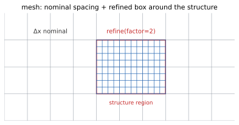

# 02 · f.mesh — grid & local refinement

> Nominal grid spacing (dx/dy/dz), box-shaped refinement regions (`refine`),
> and two global grid guards. All SI.



## `f.mesh` properties

| Property | Type / unit | Description |
|---|---|---|
| `dx` / `dy` / `dz` | m, > 0 | Nominal spacing per axis; unset `dy`/`dz` fall back to `dx`, so setting `dx` alone suffices for a uniform grid |
| `max_refinement` | int ≥ 1, default 128 | Maximum recursion depth of refine regions; leave alone in general |
| `min_cells` | int ≥ 1, default 10 | Minimum cell count per domain axis; a 422 mentioning "min_cells" means domain/spacing ratio is unbalanced |

**Total-cell-count guard.** The total cell count — including the increment contributed by refinement regions — is checked against the default deployment threshold (configurable via env) at submission time. Exceeding it fails immediately with HTTP 400, and the error message carries an estimated cell count so the offending spacing or refinement can be traced without re-running.

**Per-axis floor.** Each domain axis is guaranteed at least `min_cells = 10` cells (`genie-sdk/models/_wire.py`, line 292).

```python
f.mesh.dx = 25e-9              # same spacing on all axes
f.mesh.dx, f.mesh.dy, f.mesh.dz = 15e-9, 30e-9, 30e-9   # independent per axis
```

**Common pitfalls**

- Giving `dx` in nm (e.g. `dx = 25`) makes the domain orders of magnitude smaller than the grid — min_cells rejects it or the cell count explodes. The whole SDK is SI.
- `max_refinement`/`min_cells` are int slots: passing a float (even `10.0`) is rejected with `TypeError`.

## `f.mesh.refine()`

Refine the grid inside a box; stackable (one refinement region per call).
Returns: `Mesh` (itself — chain more `refine` calls or write properties).

| Param | Type | Required | Default | Description |
|---|---|---|---|---|
| `x_range` | (lo, hi) | Yes | — | Region extent (m) |
| `y_range` | (lo, hi) | Yes | — | Same as above |
| `z_range` | (lo, hi) | Yes | — | Same as above |
| `factor` | int / [fx, fy, fz] / str | Yes | — | Refinement factor: positive integer ≥ 2 (all axes) / per-axis 3-list such as `[2, 2, 4]` / expression string (evaluated server-side); non-integer values are rejected, not rounded; omitted → `ValueError`, no silent default |
| `growth_rate` | float | No | 1.2 | Transition ratio between adjacent spacings (≥ 1.0); `1.0` disables grading (uniform refinement); not serialized at the default |

**Region bounds.** A refinement region that extends partially beyond the domain is legal: each axis is clipped to its intersection with the domain. A region lying entirely outside the domain is rejected.

**Example**

```python
f.mesh.refine((-0.5e-6, 0.5e-6), (-0.5e-6, 0.5e-6), (0, 0.3e-6), factor=2)
f.mesh.refine(x_range=(-2e-6, -1e-6), y_range=(-1e-6, 1e-6),
              z_range=(-1e-6, 1e-6), factor=[2, 2, 4])
```

**Common pitfalls**

- `factor` has integer semantics with a positive-integer ≥ 2 requirement — non-integer values are rejected outright (no rounding to a nearby integer); pass integers ≥ 2, prefer the all-keyword form.
- Nominal factor ≠ actual finest cell: after the graded transition band is normalized for conformity, the actual finest cell can be finer than `dx / factor` (kernel-measured: factor 8 with growth_rate 1.2 yields roughly 26× refinement relative to the nominal spacing). The time step and the refinement guards are computed from the *actual* finest cell. With `growth_rate = 1.0` the actual finest cell equals the nominal value exactly.
- Refinement costs time steps, not only cells: `dt` follows from the globally finest cell via the CFL condition, so `factor = 2` approximately doubles the step count even when the refined volume is small. On a measured plate problem, the refine-based grid and the equivalent uniform grid produce consistent spectra — refinement saves cell count, not step count. Refinement combined with a plane-wave source is supported; the service aligns the time axes automatically.
- Don't place a region flush against the domain edge: refining inside the PML wastes cells and may trip the gradient guard; enclose the structure with 2–3 transition layers.

## Resolution guidance

- Optical wavelengths: start at 15–20 cells per wavelength; add resolution at metallic or high-index-contrast interfaces.
- Convergence order is approximately dx².

## `f.mesh.clear_refinements()`

Clears all refinement regions; `dx/dy/dz` and the global guards are untouched.
