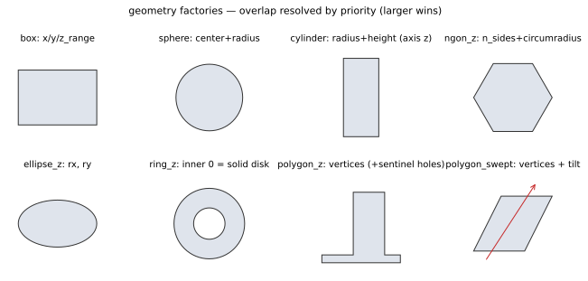

# 04 · f.geom — geometry

> Nine `add_*` factories + `clear()`. Each factory returns a chain builder;
> **in overlapping regions the larger `priority` wins** (same priority:
> later entries in list order overwrite earlier ones). A misspelled chain
> method → immediate SDK `ValueError` (linear model with extra=forbid);
> it never silently waits for a server 422.



## Shared chain conventions (all nine shapes)

| Chain method | Description |
|---|---|
| `.material(n)` | References a material name registered in `f.mat` (**required**) |
| `.center(x, y, z)` | Center in m, defaults to origin — all shapes except `box`, `polygon_z`, `polygon_swept` (which use x/y/z_range or z_range; the polygon shapes have no `.center` and calling it raises `ValueError`) |
| `.priority(n)` | Integer, larger wins, default 0 |
| `.height(h)` | Extrusion thickness along z, m, > 0 — `ngon`/`ellipse`/`ring`/`cylinder`/`sphere` shapes. `polygon_z`/`polygon_swept` have no `.height`; their vertical extent is set only via `.z_range(lo, hi)` (required) |
| `.name(s)` | Optional display name; shown in the GUI left tree and 3D labels. Names must be unique — a duplicate is rejected at submission; omit for a type-name default (`"Box"`, `"N-gon"`, …) |

A structure extending beyond the physical domain is **warned about, not rejected** — a partially outside structure may be intentional. This aligns with the pitfall noted in [Tutorial 6](tut6.html) and [Troubleshooting](troubleshooting.html): a shape that silently falls outside the domain disappears entirely from the built geometry.

## `f.geom.add_box()`

Box positioned by min/max ranges on all three axes (all six values required).

| Chain method | Description |
|---|---|
| `.x_range(lo, hi)` / `.y_range(lo, hi)` / `.z_range(lo, hi)` | Extent per axis, m, two args min/max (required) |

```python
f.geom.add_box().material('sio2') \
    .x_range(-0.5e-6, 0.5e-6).y_range(-0.5e-6, 0.5e-6) \
    .z_range(-0.1e-6, 0.1e-6).priority(1)
```

## `f.geom.add_sphere()`

Sphere; `.radius(r)` in m, > 0, required. Example: `add_sphere().material('sio2').center(0, 0, 0).radius(200e-9)`.

## `f.geom.add_cylinder()`

Cylinder with axis = z; `.radius(r)` in m, > 0, required (chain = shared conventions + `.height`).

## `f.geom.add_ngon_z()`

Regular n-gon prism extruded along z; `.n_sides(k)` ≥ 3, required (n=2 vanishes and is blocked by a guard), `.circumradius(r)` circumscribed-circle radius, m, > 0, required.

```python
f.geom.add_ngon_z().material('sio2').n_sides(6) \
    .circumradius(200e-9).height(300e-9)      # hexagonal prism
```

## `f.geom.add_polygon_z()`

Arbitrary polygon extruded along z; `.vertices([(x, y), …])` required. Vertices are **absolute domain x/y coordinates** (m) — polygon shapes have no center; ≥ 3 (sub-polygon-level validation happens in the kernel at build time), all finite. Multiple sub-polygons are separated by sentinel pairs: in Python `(None, None)` or `(nan, nan)`, in JSON text `[null, null]`; a one-sided null is invalid.

```python
f.geom.add_polygon_z().material('sio2').z_range(0, 200e-9) \
    .vertices([(-1e-6, -1e-6), (1e-6, -1e-6), (0, 1e-6)])
```

**Common pitfalls**

- Wanting to punch a hole — a hole = a background-material polygon at higher priority over the hole region, or sentinel-separated sub-polygons (forming holes per the even-odd rule).

## `f.geom.add_ellipse_z()`

Ellipse (cylinder variant) extruded along z; `.rx(a)` / `.ry(b)` semi-axes, m, > 0, required. Example: `add_ellipse_z().material('air').rx(250e-9).ry(150e-9).height(300e-9)`.

## `f.geom.add_ring_z()`

Ring or solid disk extruded along z; `.inner_radius(r)` ≥ 0 (**0 = solid disk**), `.outer_radius(R)` > 0, both required. `inner_radius ≥ outer_radius` is rejected at schema time (a reverse ring would rasterize silently into an empty mask with no warning). Example: `add_ring_z().material('sio2').inner_radius(100e-9).outer_radius(300e-9).height(220e-9)`.

## `f.geom.add_polygon_swept()`

Obliquely swept polygon: a base polygon + a lateral offset while sweeping along z (for ramps/tilted walls). Chain = all of polygon_z (same `vertices` sentinel semantics) + `.tilt(dx_dz, dy_dz)` — dimensionless slopes, two args; optional (omitted = no oblique sweep). Each component must be finite with |v| ≤ 1000; larger tilts push the cross-section outside the domain and are rejected at schema time.

```python
f.geom.add_polygon_swept().material('sio2') \
    .z_range(0, 400e-9).vertices([(-1e-6, -0.5e-6), (1e-6, -0.5e-6),
                                  (0, 0.5e-6)]).tilt(0.3, 0.0)
```

## `f.geom.clear()`

Clears all geometry (the material table is untouched); returns None. Use before batch parameterized rebuilds (e.g. changing tooth count and rerunning). Full example: [Example library](examples.html) (for-loop batch add_box of grating teeth — one loop pass = one node).
