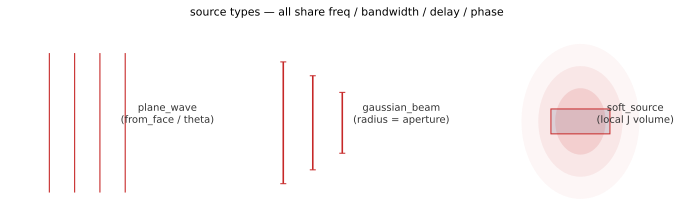

# 05 · f.src — sources

> Three source types. At least one source is required to submit
> (`source` list min_length=1). The time-domain waveform parameters
> below are chained and shared by all three families.



## Shared time-domain parameters (chained, all three families)

| Chain method | Description |
|---|---|
| `.freq(f0)` | Center frequency, Hz, > 0, required |
| `.bandwidth(bw)` | Gaussian envelope bandwidth, Hz, > 0, required |
| `.delay(t)` | Delay, s, default 0 — the automatic default is usually fine; only tune it when observing early transients. Negative values are legal (an "early pulse"; the wire imposes no lower bound) |
| `.phase(p)` | Initial phase, rad, default 0 |
| `.name(s)` | Optional name, for traceability |

## `f.src.add_soft_source()`

Soft source: injects electric/magnetic current directly within the `size` region at `center` — suited to point excitation and waveguide feeds; **not unidirectional** (radiates both ways).

| Chain method | Description |
|---|---|
| `.center(x, y, z)` | Source center, m, defaults to origin |
| `.size(x, y, z)` | Extents per axis, m; slot ≤0 = single grid point — give non-zero slots for surface/line sources |
| `.polarization(px, py, pz)` | Polarization vector; each component `complex` (e.g. `1j`) or real; defaults to x̂ linear |
| `.amplitude(a)` | Amplitude, default 1.0 |
| `.kind(k)` | `'electric'`/`'magnetic'` current, default electric |

```python
f.src.add_soft_source().freq(300e12).bandwidth(60e12) \
    .center(0, 0, -500e-9).polarization(1, 0, 0)
```

## `f.src.add_plane_wave()`

Plane wave with TFSF (total-field/scattered-field) injection — place scatterers inside the total-field region; leakage behind the source plane is already calibrated for one-way behavior, so used normally you won't see spurious fields "coming in from the back". **Prefer `from_face` to specify the incidence face** — simpler and more reliable than hand-tuning angles.

| Chain method | Description |
|---|---|
| `.from_face(face)` | One of the six faces (`x_min`…`z_max`), i.e. always an `_min` face plus a `direction`: pins the propagation axis, places the injection plane ~2.5 grid cells inside the PML inner edge of that face, and centers the transverse axes on the domain. **Overrides** any previously set `center` and propagation axis/direction; `size` and angles still combine with it. Most common |
| `.direction('+')` / `'-')` | Along the positive/negative direction of the propagation axis (with from_face/propagation_axis) |
| `.theta(deg)` / `.phi(deg)` / `.psi(deg)` | Polar θ ∈ [0, 180] (closed interval; 0 = +z) / azimuthal φ ∈ [0, 360) / polarization rotation ψ ∈ [0, 360), where ψ = 0 is s polarization (along e_h) and ψ = 90° is p polarization (along e_v). Out-of-range angles are rejected (HTTP 422) — they do not wrap around |
| `.amplitude(a)` | Amplitude, default 1.0 |
| `.size(x, y, z)` | Global transverse window: ≤0/null for the propagation-axis slot, positive for the two transverse slots |
| `.propagation_axis('x'/'y'/'z')` | Explicit propagation axis (default z, exactly one non-positive slot) |

```python
f.src.add_plane_wave().freq(300e12).bandwidth(60e12) \
    .from_face('z_min').name('pw')
```

**Common pitfalls**

- Oblique incidence + `periodic` boundary — you must use `bloch` (see [Domain & boundaries](#f-domain-physical-domain-boundaries)); also match the `size` transverse window to the bloch boundary.
- Fine-tuning `theta`/`phi` together with `from_face` — from_face is syntax sugar for normal incidence; for oblique incidence set `theta` first.
- Placing monitors near the TFSF source plane — readings mix incident + scattered fields; keep monitors a few cells away.
- Default plane-wave polarization is along **Ey** (kernel `_tfsf.py` `_wave_vectors`: φ = 0 gives e_h = v̂, so +z propagation polarizes along ŷ). A time monitor reading `field('Ex')` as identically zero reflects the polarization, not a failed injection.

## `f.src.add_gaussian_beam()`

Gaussian beam = plane wave with full parameters + a transverse Gaussian envelope (for focusing / finite-spot scenarios). Chain = all of plane wave + `.radius(r)`: **aperture radius** on the source plane (m, > 0, required) — do not treat it as the beam width w; the actual 1/e² spot is `w ≈ 0.47·r` (set `radius ≈ 2.12·w` for a desired w). Example: `add_gaussian_beam().freq(300e12).bandwidth(60e12).from_face('z_min').radius(1.5e-6)`.
