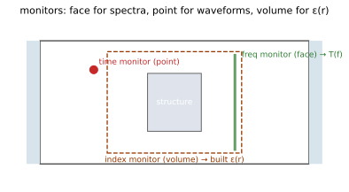

# 06 · f.mon — monitors

> Three monitor types (time/freq/index). **`name` is the addressing key when
> retrieving results** (`f.get_time('tr')`), so always name your monitors.



## Common parameters (chained)

| Param | Required | Default | Description |
|---|---|---|---|
| `.name(s)` | yes | — | Results are grouped by it in the result file |
| `.center(x, y, z)` | no | origin | Center (m) |
| `.size(x, y, z)` | no | type-specific | Extents (m); a `None` slot = full extent on that axis. time/freq default to a `(0,0,0)` point monitor, index defaults to full extent on all three |
| `.field(f)` | no | — | Field selection; valid set per subsection below |

## `f.mon.add_time()`

Time-domain recorder: logs fields at every time step — use it for pulse
waveforms and time-domain reflection. Fields: `Ex Ey Ez Hx Hy Hz all`.

```python
f.mon.add_time().name('pt').center(0, 0, 500e-9).field('Ez')
```

## `f.mon.add_freq()`

Frequency-domain recorder: DFT of the time signal, yields the complex
amplitude at each frequency point — the workhorse for transmission/reflection
spectra. Fields same as time. Frequency points use the unique three-argument
`.freq(center, bw, n)` form: center (Hz, > 0), bandwidth (Hz, ≥ 0; points
spaced with `linspace` over `[center−bw/2, center+bw/2]`, lower bound ≥ 0),
and point count (int, ≥ 1).

Optional refinements: `.down_sample((t0, t1), stride)` (time window +
decimation) and `.apodize(side, (t0, t1), width)` (window tapering,
`side ∈ start/stop/both`) suppress spectral artifacts from time-domain
truncation and reduce recorded volume.

```python
f.mon.add_freq().name('tr') \
    .center(0, 0, 500e-9).size(1e-6, 1e-6, 0) \
    .field('all').freq(300e12, 120e12, 200)
```

**Common pitfalls**

- `.freq()` must be the `(center, bw, n)` triple — a single value or list is rejected.
- Don't place a plane monitor inside the PML — fields in an absorbing layer have no physical meaning.
- Physical transmittance T requires a plane monitor plus server-side normalization: `digest` reports physical T only when `normalized=true`; point monitors have no area integral and carry no T.

## `f.mon.add_index()`

Refractive-index/material recorder: outputs the as-built `eps`/`mu`
distributions — use it to check geometry and meshing. Fields: `eps mu both`.

```python
f.mon.add_index().name('ix').field('both')   # full domain
```

**Common pitfalls**

- Wanting field maps but using index — it only gives material distributions; use time/freq for fields.

## `f.mon.clear()`

Clears the monitor list (`-> None`); pair with `f.geom.clear()` when
rebuilding the configuration.

**See also**　For the result-retrieval trio `get_time/get_freq/get_index`,
see [Results](#results-get-simdata).
