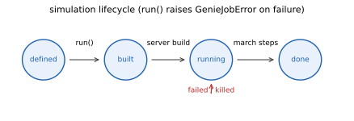

# 07 · f — submit & lifecycle

> Five everyday commands: `parameters` / `run` / `cancel` / `summary` /
> `digest`, plus the serialization pair (to_config / to_script).



## `f.parameters()`

Sets/merges the **global parameter table** (`{name: value | expression
string}`) — referenced by expression slots in any numeric config field and
by sweep axes; repeated calls accumulate.

```python
f.parameters({'d': 1e-6, 'gap': 'd / 10'})
f.mesh.dx = 'd / 40'          # expression slot: evaluated server-side
f.geom.add_box().name('core').x_range(0, 'd')
```

**Common pitfalls**

- Referencing an undefined parameter inside an expression string — the
  submission-boundary precheck rejects it outright (GenieConfigError, with
  kind/msg); nothing is evaluated locally.
- Expecting a sweep to change the `dx` literal — sweep axes can only vary **parameter names** (see page 08).

## `f.run()`

The synchronous entry point: implies submission (serialize + local precheck
+ POST), polls until a terminal state, then **automatically downloads the
results** to `<job_id>_results.h5` under `$GENIE_RESULT_DIR` (default
`./genie_results/`; on failure it only warns — `results()` re-fetches on
demand). Returns the `Simulation` itself (`state == "done"`), ready for
`f.get_freq('tr')`.

| Param | Type | Required | Default | Description |
|---|---|---|---|---|
| `gpu` | int | no | — | Number of GPUs (1..4); `None`/omitted = single GPU. Device selection, NV-link pairing and axis splitting are scheduled server-side |
| `timeout_s` | int | no | 3600 | Server-side job timeout (s) |
| `poll_interval` | float | no | 2.0 | Polling interval (s) |
| `progress` | callable | no | — | Per-poll callback `progress(status_dict)` |

Simulation length is defined solely by `domain.total_time` (SI seconds, > 0
required) — `run()` takes **no step argument**; the job advances until the
grid's time capacity is reached, and the step count is a read-only derived
value (`dt`/`n_steps` in `summary`/`results`).

```python
f.run()                                       # most common
f.run(gpu=2, progress=print)                  # dual GPU + progress callback
```

**Common pitfalls**

- Passing `gpu/timeout_s` after submission → RuntimeError (the configuration is already sent); each instance submits at most once — to change the configuration, create a new `genie.connect()`.
- Omitting `domain.total_time` → rejected before submission (it is the only definition of simulation length).
- Job failure/kill → raises `GenieJobError` (`.state` lands on `failed`/`killed`).

## `f.cancel()`

Cancels the submitted background job (`-> dict | None`); a no-op returning
None if this instance was never submitted.

## `f.summary()`

Configuration summary (domain/mesh/per-list counts/monitor names and
types/run section/state/job_id, plus the server-side job summary if
submitted). Prints and returns the dict (`-> dict`); use it to self-check
completeness before submission.

## `f.digest()`

Numeric result summary, computed server-side with zero GPU reads (`job_id:
str | None = None -> dict`, defaulting to this instance's most recent
submission): peak frequency/amplitude per monitor; plane monitors
additionally carry transmittance min/max/center-frequency values (the
physical T only when `normalized=true`). For comparisons and tuning rounds,
read this instead of downloading result files. Unsubmitted instance and no
`job_id` → RuntimeError.

## Serialization pair

| Command | Returns | Description |
|---|---|---|
| `to_config()` | dict | Current configuration → SimConfig JSON (dense: defaults spelled out explicitly) |
| `to_script(origin=None)` | str | Current configuration → genie script text (byte-identical to the Studio code generator); for provenance/sharing/papers |

```python
cfg = f.to_config()
open("share.py", "w").write(f.to_script())
```

To rebuild or copy a simulation, export the script with `to_script()` and
execute it on a **fresh `genie.connect()`** instance — that is the only
public rebuild path. To vary many parameters, build them through the
chained APIs (`f.domain` / `f.mat` / `f.geom` / `f.src` / `f.mon`) plus
`f.parameters()`.

**Common pitfalls**

- Editing a SimConfig JSON and expecting to load it back into an instance —
  `f.load_config()` is an **internal load-bearing channel, not a committed
  API** (session rollback / form channel only); its name and behavior are
  not guaranteed. Always rebuild via `to_script()` + a fresh `genie.connect()`.

**See also**　[f.expert](#connections-entry) (ask / delegate to an expert surface)
becomes available once the composition root is wired:
`f.expert.ask(...)` / `f.expert.delegate(cfg=...)`.
