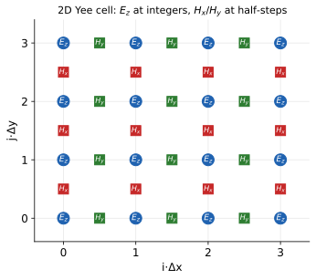
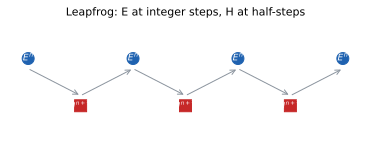

# 1 · What is FDTD?

> FDTD (Finite-Difference Time-Domain) solves Maxwell's equations directly
> on a space grid, stepping in time. This page gives the minimal math
> needed to understand every knob in the SDK. Only vector calculus is assumed.

FDTD occupies a specific niche among computational electromagnetics methods.
Frequency-domain methods (finite elements, method of moments) solve one
frequency at a time and pay for a matrix solve; FDTD instead integrates the
fields forward in time with no matrix at all. A broadband answer falls out
of a single run, because a short pulse injected into the domain carries all
frequencies of interest and every monitor records their superposition. The
price is explicit: the time step is capped by the grid spacing (the CFL
(Courant–Friedrichs–Lewy) stability limit; see below), so a run that
resolves finer structure needs
proportionally more steps. Every parameter in this SDK is a
lever on one of three things: how space is gridded, how time is stepped,
and how materials enter the update.

## The equations being solved

Maxwell's curl equations in full generality: `ε` and `μ` are in general
**tensor** distributions of position, `ε = ε̄(r)`, `μ = μ̄(r)` (anisotropy
included; isotropic media are the scalar special case) — in SI units,
lossless (no conductivity term), with electric current `J` and magnetic
current `M`:

```math
∂H/∂t = −@μ^{-1}(r) ∇×E − @μ^{-1}(r) M
∂E/∂t = @ε^{-1}(r) ∇×H − @ε^{-1}(r) J
```

Everything a FDTD code does is: discretize space, discretize time, and
integrate these two equations alternately. Given `E` at time `n`, the update yields
`H` at `n+½`; from `H` at `n+½` it yields `E` at `n+1`. This is the
**leapfrog** scheme — explicit, second-order accurate, and it needs no
matrix inversion, which is why the method maps well to GPUs.

The reason this alternation is legitimate rather than an approximation
heaped on an approximation is the structure of the equations themselves:
`∂H/∂t` depends only on `E` and `∂E/∂t` only on `H`. The two curl
equations form a coupled pair of first-order ODEs in time at every point of
space, and leapfrog integrates such pairs with the derivative evaluated at
the offset time, which is exactly centered in the interval it spans. The
result is second-order accurate in `Δt` with no extra work. The two source
terms live in different equations: `J` appears only in the `E` update —
this is where the SDK injects `f.src` objects, and it is the only
place the exterior world ever touches the simulation — while `M` appears
only in the `H` update. The solver keeps `M` in the equations for
generality but does not expose it: everything `f.src` produces is an
electric current density.

## The Yee grid

FDTD does not put all field components at the same points. The **Yee
staggered grid** offsets `E` and `H` by half a cell in each direction:



```math
E_x  at (i+½, j,   k)      H_x  at (i,   j+½, k+½)
E_y  at (i,   j+½, k)      H_y  at (i+½, j,   k+½)
E_z  at (i,   j,   k+½)    H_z  at (i+½, j+½, k)
```

This staggering makes ∇×E centered-difference accurate to second order and
automatically satisfies charge conservation. It is also why a "cell" in the
output can be half a step away from where a source is nominally placed — the
grid, not the geometry, defines the sample points.

The staggering is not an implementation convenience; it is the discrete
image of the integral form of Ampère's law. Each `E` component sits on a
face of the cell and each `H` component on an edge piercing that face, so
the loop of four `E` samples around an `H` sample is exactly a discrete
line integral of `E` around the edge, and the difference of four `H`
samples around an `E` sample is exactly a discrete circulation of `H` on
the face. Both differences are centered, which is where the second-order
accuracy comes from, and the arrangement enforces a discrete ∇·B = 0 to
machine precision for as long as the simulation runs. The practical
consequence is positional: when the SDK reports that a monitor is
at `x = 1.7 μm`, it is placed at the nearest sampling location of the
requested component, which may be up to half a cell from that
coordinate. With a 15 nm grid the discrepancy is below any physically
meaningful accuracy, but it explains small systematic offsets
when monitors on different components are compared.

## The discrete update (3D, lossless)

The Yee staggering turns the curls into centered differences. Writing
`E|_{i,j,k}^n` for `E_x(i+½,j,k)` at time `nΔt`, the z-component update is
(shown for an **isotropic** medium — `ε` is the rasterized scalar sampled
at that E location; anisotropic media run the same stencil with the tensor
inverse `ε^{-1}` component-wise. Sources are dropped in this lossless,
source-free form and re-enter exactly as the `J` term of the continuous
equation):

```math
E_z|^{n+1} = E_z|^n + (Δt/ε) · [ (H_y|^{n+½} − H_y|^{n+½}_{i−1}) / Δx
                                − (H_x|^{n+½} − H_x|^{n+½}_{j−1}) / Δy ]
```

and the magnetic update mirrors it with roles swapped and a half-step
offset:

```math
H_x|^{n+½} = H_x|^{n−½} − (Δt/μ) · [ (E_z|_j − E_z|_{j+1}) / Δy
                                   + (E_y|_{k+1} − E_y|_k) / Δz ]
```

This has two immediate consequences.

1. **Second order everywhere.** Centered differences and leapfrog are both
   `O(Δx², Δt²)` — halving `dx` buys 4× field accuracy at 8× cost
   (2× cells per axis × 2× steps).
2. **Materials enter as a local coefficient.** The rasterized material
   arrays from `f.mat`/`f.geom` are looked up per component — scalar
   `1/ε(r)` for isotropic media, the tensor inverse for anisotropic ones;
   that is the whole material interface.

A close look at the update shows that each new value depends only on
its own four neighbors and its own past value. There is no global coupling
anywhere in the scheme, which is why the kernel is a stencil sweep over a
regular array: perfectly coalesced memory access, no synchronization, near
peak GPU throughput. It also means a discontinuity in `ε` is handled
without any special code; the field at the material interface simply
updates with a different coefficient on each side. The physics of
reflection and refraction at that interface emerges from the update; it is
not put in by hand. The cost of this locality is that all knowledge the
solver has about the structure is the `ε(r)` array, so whatever errors
the rasterization introduced (staircasing of curved boundaries, half-cell
placement of facets) are errors the solver will faithfully propagate.



## What the solver does per step, in code terms

Stripped of all infrastructure, one time step is the following loop, with
every array a regular 3D grid of float32 on the GPU:

```python
for n in range(n_steps):
    # H update: half a step behind E in time, half a cell offset in space
    H += -(dt/mu) * (curl(E) + M)        # stencil over 6 neighbor reads
    apply_H_boundary(H)                  # PML/periodic correction terms
    if src_active(n): J = src_profile(n) # inject source into E next
    E += (dt/eps) * (curl(H) - J)        # stencil, symmetric to H update
    apply_E_boundary(E)
    for m in monitors: m.accumulate(E, H, n)   # running DFT (discrete Fourier transform) or time sample
```

Three things in this loop explain otherwise mysterious behavior.
First, the source is a term in the `E` update, not a separate
object living in the grid: a plane wave is implemented as an equivalent
surface current on the injection face, which is why a source can sit on a
PML face and still radiate one way. Second, boundaries are applied as
corrections after each update, so a PML is a set of extra auxiliary
variables updated alongside `E` and `H`; the cost of `layers = 12` is a
modest fraction of the total grid. Third, monitor accumulation happens
every step inside the loop at effectively zero marginal cost, which is why
a 300-point DFT monitor is free compared to the march itself, and so
there is no reluctance to add monitors: unused data is cheap, a rerun
is not.

## The discrete dispersion relation

In continuous vacuum the dispersion relation is `ω = c·k`. On the Yee
grid (3D) the discrete relation is

```math
(1/(cΔt)) · sin(ωΔt/2) =
  √( sin²(k_xΔx/2)/Δx² + sin²(k_yΔy/2)/Δy² + sin²(k_zΔz/2)/Δz² )
```

which reduces to `ω = c·k` only as `Δx,Δt → 0`. Expanding at small `k·dx`
gives a leading phase error of order `(k·dx)²/24` per wavelength: waves
slow down and, off-axis, slow down anisotropically. Keeping
`dx ≤ λ/(10·n)` bounds the phase error to ≤0.1% per wavelength on-axis,
and refinement is warranted if the observable depends on interference between paths of very
different lengths.

The anisotropy deserves attention because it is the error FDTD users
actually get bitten by. On the grid, a wave traveling along a grid axis
propagates more slowly than one traveling along the diagonal, with a
velocity difference of order a fraction of a percent at ten cells per
wavelength. A single propagating pulse barely notices. An interferometric
observable, where a weak signal is the difference between two paths, will
register the differential phase error directly. The worked rule: at
`dx = λ/(10·n)` the on-axis phase lag per wavelength is
`(2π/10)²/24 ≈ 1.6×10⁻²` rad before the `Δt` term partially cancels it;
empirically the Yee scheme's time-stepping error offsets the spatial error
on-axis, leaving combined errors near 10⁻³–10⁻⁴ per wavelength. Concrete
case: a 25 nm grid in silicon (`n ≈ 3.5`) at free-space λ₀ = 1550 nm
resolves the material wavelength λ/n = 443 nm with about 17.7 cells, safely
inside the rule. The same 25 nm grid in silica (`n ≈ 1.45`) gives 30 cells
per wavelength, which is finer than needed; that headroom is better spent
refining the silicon region only, which is precisely what
`f.mesh.refine` is for.

## The CFL time-step limit

Explicit time stepping is only stable if a signal cannot cross a cell in
one step. In 3D with spacings `dx, dy, dz`:

```math
Δt ≤ 1 / ( c · √(1/dx² + 1/dy² + 1/dz²) )
```

The SDK exposes this as `f.domain.cfl` (default **0.9**): the actual `Δt`
is `cfl ×` the stability limit. It normally needs no adjustment.

The physical reading of the inequality: the fastest signal the discrete
scheme can carry is `c`, and in one step `Δt` the update stencil couples
each component to neighbors at distances `dx, dy, dz`. If `cΔt` exceeds
`1/√(1/dx²+1/dy²+1/dz²)`, information traverses the stencil faster than
the finite difference can represent, and round-off grows without bound;
the run diverges to NaN within a few hundred steps. The factor 0.9 is a
safety margin, not a tuning knob: it exists because material interfaces
and PML regions locally stiffen the discrete problem. Lowering `cfl`
further costs steps without buying accuracy, since the scheme's accuracy
is dominated by `Δx`, not `Δt`, once stability holds.

Worked number. For the common cubic case `dx = dy = dz = 25 nm` the
stability limit is `Δt_max = 25×10⁻⁹ / (c√3) = 4.81×10⁻¹⁷ s ≈ 0.0481 fs`,
and with the default `cfl = 0.9` the solver runs at
`Δt ≈ 0.0433 fs`. A run with `total_time = 100 fs` then costs
`n_steps ≈ 100 / 0.0433 ≈ 2310` steps. The same formulas on the anisotropic
Quickstart grid (`dx = 15 nm`, `dy = dz = 30 nm`) give
`1/√(1/dx²+1/dy²+1/dz²) = 1/(8.17×10⁷ m⁻¹) = 4.08×10⁻¹⁷ s`, so
`Δt ≈ 0.0367 fs`: refining one axis by 2× raised the step count per
simulated femtosecond from about 23 to about 27. The step count is set by
the *finest* axis, which is the honest way to price local refinement.

The total simulated time is `f.domain.total_time` (seconds) — the single
time knob. At build the server derives the step count:

```math
n_steps ≈ total_time / Δt
```

`n_steps` is a read-only derived value (reported in `summary`/`results`);
`f.run()` takes no step argument — the job simply marches until the grid's
time capacity (`total_time`) is reached.

## Numerical dispersion

On a grid, waves of wavelength `λ` propagate at slightly the wrong speed:
the phase error scales roughly as `(2π·dx/λ)²`. The standard rule of thumb
is **at least 10 cells per wavelength in the highest-index material**
(`dx ≈ λ/(10·n)`), and finer near resonant structures. That is exactly what
`f.mesh.dx` and `f.mesh.refine(..., factor=k)` control:

```python
f.mesh.dx = 25e-9                    # nominal spacing everywhere
f.mesh.refine((−0.5e−6, 0.5e−6),     # …with 2× refinement in a box
              (−0.5e−6, 0.5e−6),
              (0, 0.3e−6), factor=2)
```

Resonators deserve the finer language. A cavity of quality factor `Q`
stores the field for `Q/(π f₀)` of time, i.e. `Q` optical cycles divided
by π, and over that lifetime the numerical phase error accumulated at
`Δv/v ≈ 10⁻⁴` shifts the resonance by roughly `f₀·10⁻⁴`. For a resonance
at 200 THz that is a 20 GHz shift, which is easily visible in a
high-resolution spectrum. The rule of thumb "finer near resonant
structures" is therefore not about resolving geometry: it is about keeping
the total phase error accumulated over the ring-down below the shift
intended to be measured. If the observable is a broadband transmission spectrum
with 30 GHz features, 10–15 cells per wavelength suffices; if it is a
Q = 10⁴ mode frequency to within 0.1%, refinement should be budgeted
accordingly and verified by halving `dx` once.

## What a simulation actually computes

1. **Build**: the config (materials, geometry) is rasterized onto the Yee
   grid → arrays `ε(r)`, `μ(r)`.
2. **March**: source injects `J`; leapfrog updates `E`/`H` for `n_steps`;
   monitors accumulate their data as the wave passes.
3. **Read out**: monitors return either raw time series (`add_time`) or
   DFTs at chosen frequencies (`add_freq`).

The build stage is a one-time cost, typically seconds, and it is where
geometry mistakes surface as unexpected `ε(r)` — a frequency monitor
placed in the wrong material produces plausible-looking but wrong spectra
without any warning, so it is worth a `f.digest()` check before the march.
The march dominates the runtime and scales as `n_cells × n_steps`, both of
which are under direct control. The read-out is server-side and free. The overall
economics are worth internalizing early: for a fixed grid, doubling
`total_time` doubles cost but adds spectral resolution `δf ≈ 1/total_time`
and ring-down fidelity; halving `dx` costs roughly 16× but quadruples
field accuracy. Deciding which resource the observable actually needs is
most of the craft in setting up FDTD simulations.

The rest of the tutorials walk each
ingredient in the same order the SDK presents them: [domain and
boundaries](tut3.html), [materials](tut4.html),
[sources and monitors](tut5.html), and finally [how to read
results](tut6.html).
