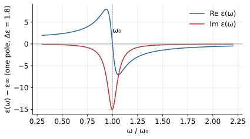
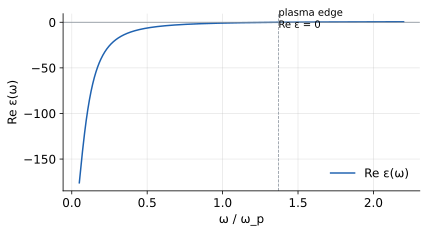

# 4 · Materials — dispersion models

> FDTD needs the material response ε(ω) in a form that can be evaluated in
> the time domain. The kernel accepts two families: a constant ε, and a
> sum of Lorentz/Drude resonance poles. This page gives both models, their
> parameters, and when each is appropriate.

FDTD solves Maxwell's equations as local difference equations on a
grid, stepping forward in time, so every quantity in the update must be
computable *at the current time step* from values the solver already
holds. A tabulated ε(ω) is the wrong currency: converting it to the
time domain means a convolution with a susceptibility stretching over
the whole simulation history, exactly the cost a time-domain method
cannot afford. The way out is to restrict materials to response
functions that obey a small number of local differential equations in
time; both families on this page have that property, and it alone is
the real admission criterion. Physical accuracy is a separate question,
handled at the end of this page.

## Where ε(ω) comes from

The response is defined by the polarization
`P(t)` to a field `E(t)`, with `D = ε₀E + P`. In the linear, time
invariant case the most general local response is a convolution —
frequency domain multiplication:

```math
P(t) = ε₀ ∫ χ(t−t′) E(t′) dt′   ⇔   D̃(ω) = ε₀ (1 + χ̃(ω)) Ẽ(ω) = ε₀ ε(ω) Ẽ(ω)
```

Causality (`χ(t) = 0` for `t < 0`) forces ε(ω) to be analytic with
Re/Im related by Kramers–Kronig — a constant ε is the trivial
`χ̃ = const` case, and every resonant model must reproduce the KK
fall-off `χ ∼ 1/ω²` at high frequency. That requirement is exactly what
the pole form satisfies naturally.

Causality is not an ornament on the formulas; it is the working tool.
It says the real and imaginary parts of ε(ω) cannot be chosen
independently, so a fit that gets Re ε right *must* come with the Im ε
that causality demands. When a material model violates this, the solver
still runs (the pole ODEs are stable regardless) but the fields are not
the response of any causal medium: reflections, delays, and energy
bookkeeping are quietly wrong. Pole models built from real oscillator
physics satisfy the KK relations by construction.

## Constant materials

The simplest response — polarization follows the field instantaneously:

```math
D(t) = ε₀·ε·E(t)
```

Physically this describes the limit in which all bound-charge resonances
of the medium sit far above the frequencies being simulated, so within the
band the susceptibility looks flat. Glass at visible frequencies is the
textbook case: the electronic resonance of silica lies in the deep UV,
and across 400–700 nm the refractive index varies by only a few percent.
Whenever the band is narrow relative to the nearest resonance, a
constant ε is both cheaper and more stable than a fitted dispersion.

`f.mat.add_const()` takes `eps` (and optionally `mu`), each as a scalar
(isotropic), a 3-vector `[εxx, εyy, εzz]` (diagonal anisotropic), or a
symmetric 3×3 tensor. Guards: finite, positive main diagonal; symmetric
(off-diagonals may be negative — that is optical activity territory).
A **negative constant ε is rejected**: it is nondispersive and numerically
unstable; metals must be expressed as poles.

The rejection of negative constant ε deserves explanation, because it
occasionally surprises newcomers with a textbook value in hand. A
constant negative ε is nondispersive: its magnitude does not decrease at
high frequency. Dispersion is what tames the update, since the
polarization of a resonant medium cannot follow the field arbitrarily
fast and that built-in lag keeps the coupled system stable. Strip the
dispersion away and keep only the negative ε, and the solver is asked
to support a medium with unlimited instantaneous response strength.
Real metals are negative-ε materials *together with* strong dispersion;
the pole representation carries both halves.

## Lorentz poles

A bound-charge resonance — damped harmonic oscillator per unit volume —
contributes to the relative permittivity:

```math
ε(ω) = ε∞ + Σⱼ  Δεⱼ · ω₀ⱼ² / (ω₀ⱼ² − ω² − i·γⱼ·ω)
```

(written in the `e^{−iωt}` convention used throughout this page).

Each pole is a small physical system: a charge bound to an equilibrium
position, driven by the field, losing energy at rate γ. Below the
resonance the charge can follow the field and the contribution to ε is
positive; above it the charge cannot keep up, the sign of the response
reverses, and ε dips. The `ε∞` term collects everything faster than the
modeled poles: high-energy resonances that matter only as a
frequency-independent background offset.

with three parameters per pole, all in `f.mat.add_lorentz()`:

| Parameter | Symbol | Meaning | Units |
|---|---|---|---|
| `omega_0` | ω₀ | resonance angular frequency (must be > 0) | rad/s |
| `gamma` | γ | damping rate | rad/s |
| `delta_eps` | Δε | oscillator strength (static contribution Δε at ω→0) | — |

```python
f.mat.add_lorentz().name('resonator') \
    .eps_inf(1.5) \
    .add_eps_lorentz_pole(4.5e15, 1.3e15, 2.5)
```



Near ω₀ the pole produces a resonance in Re ε and an absorption peak in
Im ε — this single functional form covers dielectric resonances,
phonons, and interband transitions of noble metals.

**Derivation.** A bound charge `q` of mass `m` driven by the field obeys

```math
ẍ + γ·ẋ + ω₀²·x = (q/m)·E(t)
```

Insert the ansatz `x = x_ω·e^{−iωt}` with `E = E_ω·e^{−iωt}`, solve for
`x_ω`, and use `P = N·q·x` with number density `N`:

```math
χ(ω) = (Nq²/m) / (ω₀² − ω² − iγω)  =  Δε·ω₀² / (ω₀² − ω² + iγω)
```

with `Δε ≡ Nq²/(mε₀ω₀²)` — the three parameters are the oscillator's
natural frequency, damping, and static strength. In the time domain this
polarization obeys the ODE

```math
dP/dt + γP + ω₀²·∫P = Δε·ε₀·ω₀²·E
```

which FDTD integrates with its own leapfrog, alongside the field update —
this is precisely how dispersive materials stay cheap: one extra local
ODE per pole, no convolution. The cost scaling is worth internalizing,
because it drives pole-count decisions later. Each pole adds one
auxiliary field component per grid cell that carries the material, plus
the arithmetic of its update, so memory and runtime grow roughly
linearly in pole count while a constant material costs nothing extra.
The art of material fitting is getting adequate accuracy with the
fewest poles the band demands.

**Worked numbers.** Take a gold-like metal at the green edge of the
visible, λ = 550 nm. The angular frequency is
`ω = 2πc/λ = 2π·(3×10⁸)/(550×10⁻⁹) ≈ 3.4×10¹⁵ rad/s`. Handbooks quote
Re ε ≈ −5 at this wavelength. That single number says the free
electrons are screening strongly: the displacement current through the
medium nearly cancels the vacuum displacement current, the field is
expelled, and the material behaves optically as a metal rather than a
lossy dielectric; a constant-ε model is out of the question and a pole
model is mandatory. To reproduce Im ε over a 100 THz window around this
frequency the fit typically needs the Drude term plus two to four Lorentz
poles: Drude owns the broad screening background and each Lorentz pole
covers one interband feature. One pole alone bends ε too slowly to track
the steep rise of Im ε near interband thresholds and the slow Drude tail
at once, and the fit residuals make this obvious immediately.

## Drude poles

Free carriers (metals, doped semiconductors) are the ω₀ → 0 limit, where
the restoring force vanishes:

```math
ε(ω) = ε∞ − ω_p² / (ω² + i·γ·ω)
```



`f.mat.add_eps_drude_pole(omega_p, gamma)` takes the plasma frequency
`omega_p > 0` (rad/s) and `gamma`. A metallic ε with `ε_inf` plus one
Drude and a few Lorentz poles is the standard model for gold and silver
in the visible/NIR.

The physical picture behind the sign is worth carrying around. In a
metal the conduction electrons are not bound: pushed by the field, they
simply accelerate, accumulating 180° of phase lag within half a cycle
for ω below ω_p. The polarization that results opposes the applied
field, and ε drops below one, then below zero. Below the plasma edge
the wave becomes an evanescent screening field, which is why polished
metals reflect; doping a semiconductor moves carriers into the same
regime, which is why Drude models also describe plasmonic
semiconductors and transparent conducting oxides.

**Derivation.** Drude is the free-carrier limit of the same oscillator:
drop the restoring term (`ω₀ → 0`) in Newton's equation

```math
dp/dt = −γ·p − q·E(t),   P = N·q·x = N·p/q  ⇒  χ(ω) = −ω_p²/(ω² + iγω)
```

with `ω_p² = Nq²/(mε₀)` the plasma frequency. The sign is the giveaway:
Drude contributes **negative** Re ε below `ω_p` — the screening that
makes metals reflective. Note that both derivations share the static
strength identity `ω_p² = Δε·ω₀²`; that identity is the kernel's uniform
Lorentz storage convention (a lorentz pole stores `ωp² = Δε·ω₀²`), so
each pole is stored once and expanded consistently.

## The sign convention

- **γ < 0 is rejected.** Negative damping is not gain — the gain channel
  is a *negative oscillator strength* (Δε < 0 on a Lorentz pole,
  equivalently ωp² < 0), which the kernel accepts as a bounded, stable pump model.
- **ω₀ = 0 is Drude's job.** A Lorentz pole with ω₀ = 0 is rejected.

The reasoning behind the first guard is subtle enough to state plainly.
Damping with γ > 0 removes energy from the field into heat, which is
what passive media do. Flip the sign and the pole pumps energy into
every field, everywhere, at all frequencies — an unphysical amplifier
with no inversion mechanism, and the simulation diverges. A laser, by
contrast, has gain in a *specific band* with finite saturation, and a
negative oscillator strength under a Lorentz lineshape reproduces
exactly that: gain concentrated near ω₀, bounded and stable. The kernel
keeps the physical door open and closes the divergent one.

## Anisotropy: iso and rank-1 poles

Each pole is either **iso** (the formulas above apply per axis with the
same numbers) or **rank-1**: supply `alpha=[x,y,z]` (and optionally
`beta`, default = alpha) to confine the resonance to one direction,
giving

```math
ε(ω) = ε∞·I + Δε·ω₀²/(ω₀² − ω² − iγ·ω) · α̂β̂ᵀ
```

The rank-1 form describes media whose resonances respond to one field
direction but not the orthogonal ones. Carbon nanotube arrays, chain
metamaterials, and molecular monolayers all have resonances tied to a
structural axis; along it the electrons can move and the pole is
strong, across it they cannot and the response is background only. The
alternative is to stack two independent sets of axis poles, more
flexible but with doubled bookkeeping; for a genuinely single dipolar
axis, the rank-1 form is the honest and cheaper encoding.

Direction vectors are normalized automatically; zero vectors are
rejected. Axis-independent parameters = stack several poles.

## Getting real material data as poles

Fitting poles by hand is rarely necessary. `f.mat.add_from_library('Au', …)` loads
bundled n-k data, fits `ε∞ + poles` on the client (identical to the server-side fit),
and registers
the lorentz node — see [10 · genie.material](10-fit-nk.html) for
`fit_range`, pole-count trade-offs, and fitting custom measurement data. A bare
`from_library` node in the config is rejected; the error message lists
the supported routes.

The workflow exists because handbook data arrives as tables of n and k,
never as poles, and the conversion is a nonlinear least-squares problem
with real trade-offs: more poles always lower the residual and always
raise the simulation cost, and the improvement concentrates at the
sharpest spectral feature. The practical strategy is to set `fit_range`
to the band the sources and monitors actually occupy and judge the fit
only inside it, because a pole model is a contract for a frequency
range, not a global theory of the material.

## Checking a material model before trusting it

Three checks, in increasing order of effort, catch nearly every bad
material model before it costs a simulation campaign. First, plot
the model: reconstruct ε(ω) from `ε∞` and the fitted poles over the
band, on a dense frequency grid, and compare Re ε against the tabulated
Re ε and Im ε against the tabulated 2nk (since `Im ε = 2nk`).
This plot exposes the two standard failure modes at a glance: a fit that
misses Im ε badly around an interband edge means too few poles for the
sharpness, and a fit that wiggles between data points means the fitter
is interpolating measurement noise rather than physics.

Second, check causality consistency. For a pole model this is automatic
in exact arithmetic, so what is really being checked is the *plot and
conversions*: recompute Im ε from the plotted Re ε via the KK relation
in outline and confirm they are at least of the same magnitude and
shape. A gross mismatch almost always means a transcription error, such
as radians confused with Hz (`ω₀ = 2πf`, so a pole entered in Hz is off
by 6.3×) or ε and ε−1 conflated.

Third, compare Im ε against the tabulated nk at a handful of spot
frequencies, expressed as absorption. At λ = 550 nm, gold with n ≈ 0.47
and k ≈ 2.4 gives Im ε = 2nk ≈ 2.3; if the fitted model's Im ε there is
0.5, the material transmits far more energy unabsorbed than gold, and
every extinction or heating result is wrong in a way no grid refinement
repairs. A pole fit is only as trustworthy as this last comparison.
