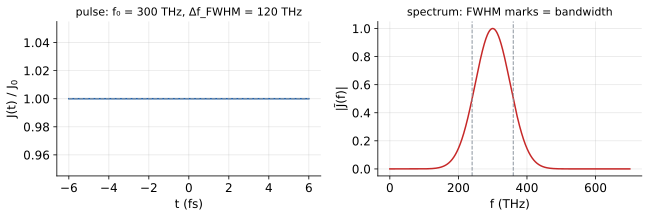
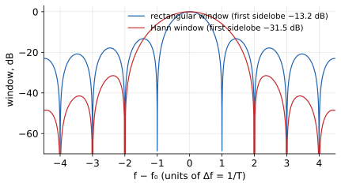

# 5 · Sources and monitors

> The source injects a known field; monitors record what the structure
> does to it. Everything measurable in your simulation is decided by how
> you pair these two. This page gives the time/frequency math and the
> practical pairing rules.

A simulation result is only as meaningful as its excitation and its
measurement chain. The source determines which frequencies exist in the
problem at all: a narrow pulse interrogates a wide band coarsely, a long
narrowband run interrogates one frequency precisely, and no amount of
post-processing can recover spectral detail the source never injected.
The monitors determine what is recorded of that response, and their
placement and sampling fix the ceiling on what the recorded data can
tell you. Getting the pairing wrong produces simulations that run
cleanly and finish quickly and answer a question you did not ask.

## The source waveform

All sources share one temporal envelope — a Gaussian-modulated cosine:

```math
J(t) = Re{ E₀ · e^{−(t−t₀)²/(2σ²)} · e^{−i·2π·f₀·t} }
```



Its Fourier transform is again a Gaussian centered at `f₀`:

```math
|J̃(f)| ∝ exp( −(f − f₀)²·2π²σ² )
```

With `σ` in seconds, the transform is exact and analytic:

```math
J̃(f) = √(2π)·σ·E₀ · exp( −2π²σ²(f − f₀)² )
```

The Gaussian is the standard choice for a reason beyond convenience.
It is the unique pulse whose spectral width is minimum for its temporal
width, so it wastes the least simulation time per unit of spectral
coverage. It also has no sidelobes: unlike a rectangular or sinc-shaped
envelope, its spectrum decays monotonically, so a pulse meant for one
band does not sneak energy into distant resonances of the structure.

The SDK parameters map as: `freq` = `f₀` (Hz), `bandwidth` = the Gaussian
bandwidth (Hz). A pulse with bandwidth `bw` resolves spectral features
coarser than roughly `bw` — and, by time-bandwidth duality, its duration
is `~1/bw`, so **wide bandwidth = short pulse = short simulation**.
`delay` shifts `t₀` (useful to let the pulse fully enter before hitting
the structure), `phase` adds a constant phase. Useful time–bandwidth bookkeeping:

```math
Δt_FWHM = 2√(2 ln2)·σ ,   Δf_FWHM = 2√(2 ln2)/(2πσ) ,   Δt_FWHM · Δf_FWHM = 0.441
```

so specifying `bandwidth` fixes the pulse length — a 120 THz bandwidth
pulse is ~3.7 fs FWHM and needs only a few fs of runout; a 1 MHz-wide
scan of a high-Q cavity cannot be driven by one pulse at all (see `Δf ≈
1/total_time` below).

**Worked numbers.** For `f₀ = 300 THz` and `bw = 120 THz`: since
`Δf_FWHM · Δt_FWHM = 0.441`, the pulse duration is
`Δt_FWHM = 0.441/(120×10¹²) ≈ 3.7 fs`. That is fewer than four optical
cycles at 300 THz (one cycle is 1/f₀ ≈ 3.3 fs), so the pulse is close to
the extreme of what "narrowband carrier plus envelope" language still
describes, and it covers the band 240–360 THz in a single shot. This is
the right source for broadband transmission through a photonic-crystal
slab; it is the wrong source for a narrow filter, where 100 THz of
spectrum is spent on frequencies you will never look at while the filter
line itself receives only a few GHz of honest resolution.

At the other extreme, consider a cavity measurement run for
`T = 100 fs`. The achievable spectral resolution is `Δf = 1/T = 10 GHz`.
A cavity with `Q = 10000` at 300 THz has a linewidth
`f₀/Q = 30 MHz`, three orders of magnitude finer than the 10 GHz grid
of frequencies your run can distinguish. The cavity's response exists in
the data only as an unresolved spike on a coarse comb; you cannot report
its Q, and even its center frequency is uncertain to the grid spacing.
High-Q measurements are budgeted in total run time, not in source
bandwidth, which is the central lesson of this page.

## Choosing a source type

| Type | Field injected | Use when |
|---|---|---|
| `add_plane_wave` | uniform on a plane (TFSF formalism) | far-field excitation, scattering problems |
| `add_gaussian_beam` | plane wave × transverse Gaussian envelope | focused / finite beams |
| `add_soft_source` | local current volume `J(r)` | waveguide feeds, point dipoles, custom injection |

The choice follows from how the real experiment illuminates the
structure. A solar-cell or metasurface calculation lives in the plane
wave limit because the illumination is kilometers away relative to the
device; a lens-coupled sensor needs the Gaussian beam because the
focusing geometry is part of the physics; a waveguide ring resonator is
fed through its port waveguide, and only a soft source inside that
waveguide reproduces the mode-matched injection without modelling an
actual laser.

The plane wave is a **total-field/scattered-field** source: fields inside
its window follow the analytic incoming wave exactly; the structure
scatters against it. Place it on a face with `from_face('z_min')`, or
steer with `theta/phi` — for oblique incidence with periodic boundaries,
the boundary must be `bloch` (see
[03 · Boundaries](boundaries-and-domain-size.html)).

The TFSF machinery matters because it keeps the incident field defined
even where a pure field-injection scheme would fail: the source surface
imposes the known incoming wave, and everywhere else the solver evolves
total fields, so the scattered field is obtained by subtraction against
the analytic incident wave rather than by a second reference run. The
practical consequence for you is that a plane wave simulation needs the
source plane and the monitors to respect the TFSF geometry: monitors
between source and structure measure incident plus scattered fields and
are not transmission by themselves.

The Gaussian beam's `radius` is the **aperture radius** on the source
plane: the 1/e² intensity beam width is `w ≈ 0.47·radius`.

This distinction is a recurring source of factor-of-two confusion. If
your experiment quotes a beam waist `w₀ = 2 μm`, you must set
`radius ≈ 4.3 μm`, not 2 μm. Feeding the waist value directly produces a
beam twice as broad as intended, and the mismatch is invisible in field
plots: the beam still looks like a beam. Verify the actual profile once
with a transverse field slice at the source plane, or by comparing the
numerically propagated divergence against the Gaussian prediction
`θ ≈ λ/(πw)`.

## Frequency monitors are DFTs

A freq monitor does not store time series. As the wave passes, it
accumulates, per requested frequency `fₖ`:

```math
Ẽ(fₖ) = Σₙ  E(tₙ) · w(tₙ) · e^{+i·2π·fₖ·tₙ} · Δt
```

a discrete Fourier transform at exactly the `n` points you asked for via
`.freq(center, bw, n)` — they linspace across `[center − bw/2, center +
bw/2]`. Spectral resolution is limited by the simulated time:
`Δf ≈ 1/total_time`, so a `Q = 1000` resonance at 300 THz needs ~5 ps of
total time to resolve. `apodize` applies the window `w(t)` to suppress
truncation artifacts; `down_sample` thins storage, not physics.

The accumulated-complex-sum formulation is what makes broadband FDTD
spectroscopy affordable: the time series is never stored, and each
requested frequency costs one complex multiply-add per time step per
field component. The corollary is that the frequency list is frozen when
the simulation starts. Request the band you need generously (a few tens
of points across the feature of interest is usually enough, since
Lorentzian lines are smooth between samples), because there is no
re-sampling later from the same run.

Resolution and leakage are quantifiable. A finite record of length `T`
is a rectangle window; its transform is a sinc with first sidelobe at
**−13.2 dB** and first zero at `1/T` — that sinc convolves your spectrum
and rings around sharp features. The Hann window (`apodize`) trades 2×
main-lobe width for **−31.5 dB** sidelobes:

```math
Δf = 1/T ,   W_rect(f) = T·sinc(fT) ,   W_hann: sidelobe ≤ 10^{−31.5/10}
```



Rule: resolve two peaks ⇒ `Δf < |f₁ − f₂|`; kill ringing around a sharp
resonance ⇒ `apodize('both')` and accept the broadened lineshape.

The −13.2 dB number is worth memorizing because it sets the dynamic
range of any unwindowed spectrum. Sidelobes only 18 dB below the main
peak mean that a weak feature sitting within a few `1/T` of a strong one
is buried under the strong feature's ringing, and it will look like
physics — ripples have structure and invite over-interpretation. When a
spectrum shows a comb of ripples with spacing `1/T` around a sharp line,
that comb is the rectangle window, not resonances; rerun with `apodize`
before believing it.

Time monitors (`add_time`) store the raw series `E(tₙ)` — use them to see
pulses, reflections, and to check that the field has actually decayed
before the run ends.

The decay check deserves emphasis because it is the single cheapest
error detector in the workflow. A time monitor placed where the residual
field is visible shows at a glance whether the run ended while the
structure was still ringing; a spectrum computed from a truncated
ring-down is a convolution of the true lineshape with a sinc, which
broadens the line, moves its apparent center, and decorates it with
sidelobes. Tutorial 6 turns this into a full checklist.

## Normalization, end to end

Transmission and reflection are ratios, and the ratio is what removes
the source from the measurement. The complete procedure uses two runs
over the identical grid, sources, and monitor set: one with the
structure, one with the structure removed (replaced by the background
medium). The structure-less run's face monitor records the incident
flux `P_inc(f)`, and the full run's monitor records `P(f)`; the
physical transmission is `T(f) = P(f)/P_inc(f)`.

The division cancels more than the source spectrum. It also cancels the
Gaussian window in the DFT kernel, the grid discretization error common
to both runs, and any constant phase or amplitude offset of the source,
because every multiplicative factor appearing in both numerator and
denominator drops out. What survives is a property of the structure
alone, which is why a normalized spectrum is comparable across runs,
across grids, and against experiment, while raw `|Ẽ|²` from a single
run is comparable to nothing.

For **reflection**, with a TFSF plane wave, incident and scattered fields
superpose linearly; the reflected amplitude is the scattered field on a
face between source and structure. The incident reference can be
obtained from the structure-less run's same face, since with nothing to
reflect, its field there *is* the incident wave. Reflection from
oblique or anisotropic problems may need the two polarization
components separated before the flux ratio is taken.

In practice much of this is automated: the server computes reference
fluxes and reports normalized transmission in `digest()` (face monitors
only; point monitors have no area and report no `T`). Automation is not
a substitute for understanding, though, because it is exactly the runs
where the reference was invalid (wrong monitor size, structure
spilling out of the reference aperture) that automation faithfully
propagates into a wrong but plausible-looking number.

## Measuring transmission properly

The canonical power measurement: a **face monitor** behind the structure,
with the same size as the incident beam. The monitor integrates the
normal Poynting flux:

```math
P(f) = ½ ∫ Re{ E × H* } · n̂ dA        T(f) = P_trans(f) / P_inc(f)
```

The server computes this in `digest()` — the throughput numbers marked
`normalized=true` are physical `T`; point monitors have no area integral
and report no `T`.

"The same size as the incident beam" is doing real work in that sentence.
A monitor smaller than the beam clips power and reads a low
transmission; a monitor larger than the beam is safe in principle but
collects stray power that bypassed the structure through the boundaries,
which reads high. The conservative choice is a monitor spanning the full
cross-section of the domain for collimated problems, and a beam-sized
monitor only once you have verified the scattered field outside the beam
aperture is negligible.

Write out both normalizations. For **transmission**, divide by
the incident flux of the *same* simulation without the structure (or the
server's reference), so source spectrum cancels:

```math
T(f) = |Σ A_trans(f)|² / |Σ A_ref(f)|²
```

For **reflection** with a TFSF plane wave, incident and scattered fields
superpose linearly; the reflected amplitude is the scattered field on a
face between source and structure, and `R + T + A = 1` becomes your
conservation check — if it fails, either the box is too small (light
bypassing a monitor) or the run truncated a resonance. For reflection, place a second face monitor between
the source and the structure and decompose incident/scattered fields.

The conservation check deserves promotion to habit. Absorption computed
as `1 − R − T` is only as good as the flux collection, and a failing
check is information about the simulation, not about the material: light
escaping through the lateral boundaries, a monitor clipping a diffracted
order, or a resonance still ringing at cutoff each produce a
characteristic deficit. Treat a few percent of unexplained missing
power as a bug to find, not a rounding error to wave past.

## Continue

- Exact parameter tables: [05 · f.src](f-src-sources.html),
  [06 · f.mon](f-mon-monitors.html)
- Reading what you measured: [06 · Reading results](reading-results.html)
